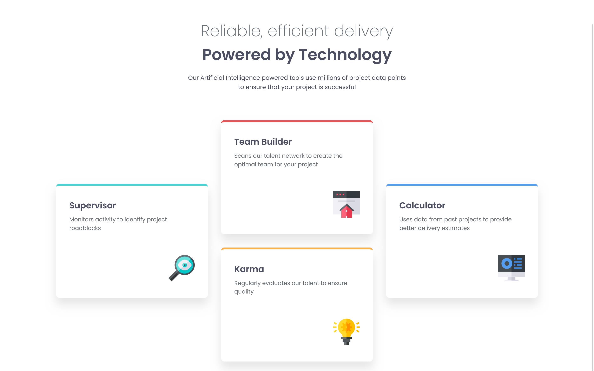

# Frontend Mentor - Four Card Feature Section Solution

This is a solution to the [Four Card Feature Section challenge on Frontend Mentor](https://www.frontendmentor.io/challenges/four-card-feature-section-weK1eFYK). Frontend Mentor challenges help you improve your coding skills by building realistic projects.

## Table of Contents

- [Overview](#overview)
  - [The challenge](#the-challenge)
  - [Screenshot](#screenshot)
  - [Links](#links)
- [My process](#my-process)
  - [Built with](#built-with)
  - [What I learned](#what-i-learned)
  - [Continued development](#continued-development)
  - [Useful resources](#useful-resources)
  - [AI Collaboration](#ai-collaboration)
- [Author](#author)

## Overview

### The challenge

Users should be able to:

- View the optimal layout for the site depending on their device's screen size.

### Screenshot



### Links

- Solution URL: [https://github.com/Danedey/practice-four-cards](https://github.com/Danedey/practice-four-cards)
- Live Site URL: [https://danedey.github.io/practice-four-cards/](https://danedey.github.io/practice-four-cards/)

## My process

### Built with

- Semantic HTML5 markup
- CSS custom properties
- Flexbox
- CSS Grid
- Mobile-first workflow

### What I learned

When you have different sections that are later going to be displayed as cards on your website, you can wrap them all inside an unordered list like this:

From this:

```html
<section>
  <h2>Supervisor</h2>
  <p>Monitors activity to identify project roadblocks</p>
</section>

<section>
  <h2>Team Builder</h2>
  <p>Scans our talent network to create the optimal team for your project</p>
</section>

<section>
  <h2>Karma</h2>
  <p>Regularly evaluates our talent to ensure quality</p>
</section>

<section>
  <h2>Calculator</h2>
  <p>Uses data from past projects to provide better delivery estimates</p>
</section>
```

To this:

```html
<ul>
  <li>
    <section>
      <h2>Supervisor</h2>
      <p>Monitors activity to identify project roadblocks</p>
    </section>
  </li>
  <div class="column-container">
    <li>
      <section>
        <h2>Team Builder</h2>
        <p>Scans our talent network to create the optimal team for your project</p>
      </section>
    </li>
    <li>
      <section>
        <h2>Karma</h2>
        <p>Regularly evaluates our talent to ensure quality</p>
      </section>
    </li>
  </div>
  <li>
    <section>
      <h2>Calculator</h2>
      <p>Uses data from past projects to provide better delivery estimates</p>
    </section>
  </li>
</ul>
```

And another thing I realized is that when you change the CSS property `flex-direction` from `column` to `row`, the `justify-content` and `align-items` properties exchange their behavior.

### Continued development

I want to sharpen my layout-making skills because I didn't feel comfortable enough with the approach I used to make a diamond-like figure with four cards. I needed to put two cards in a column right in the center, with one card beside each side, on the left and right. So, I wrapped these two cards in a div container and then centered it.

### Useful resources

- [CSS Layout: Flexbox](https://developer.mozilla.org/en-US/docs/Learn_web_development/Core/CSS_layout/Flexbox) - This helped me understand why my flex container centers along the x-axis using `justify-content: center` when you set `flex-direction` to `column`. It has something to do with the main axis.
- [CSS Layout: Grids](https://developer.mozilla.org/en-US/docs/Learn_web_development/Core/CSS_layout/Grids) - This article helped me understand how to use grid areas for a custom layout.

### AI Collaboration

I used Copilot to ask how I could handle font sizes on my page so that I ended up using good practices. It was okay.

I used Claude again to compare my approach to structuring HTML files. I learned a few things.

## Author

- Frontend Mentor - [@Danedey](https://www.frontendmentor.io/profile/Danedey)